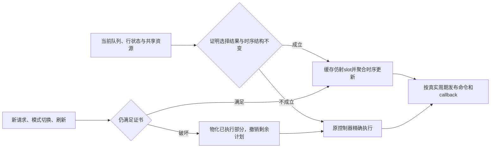

# 研究方法：资源依赖、调度证书与符号求值

研究问题不是“是否存在完全没有干扰的长 trace”，而是：**存在并发请求时，能否低成本证明
一段调度依赖保持不变，并直接求出这一段的时间和状态转移？**

首轮全局隔离的0%只刻画一个过强守卫。它不决定多面体/符号模型的研究价值。
本轮把已知顺序的数学求值、在线顺序证明和实际完整收益分开验收。

## 1. 两个不同的数学问题

在依赖已确定的区域，时间可以写为：

\[
t_v=\max\left(a_v,\max_{u\in Pred(v)}(t_u+\ell_{uv})\right).
\]

这是 max-plus 依赖图求值，可以按拓扑顺序计算。请求到达、命令总线、数据总线、bank私有
时序、刷新、pending FIFO都可能贡献前驱。ACT的四次激活窗口对应更早的第4个ACT前驱，
不能只保存最后一次ACT。

但 **Pred(v)不是天然已知**：FR-FCFS的ready比较、active/priority优先级、读写队列阈值和
新到达会改变候选。给定合法命令顺序，不一定只靠物理时序就能重现控制器故意等待的时间。
因此区分：

* C：参考执行提供顺序、接纳/入pending次序及必要的队列策略分支，用图检验时间求值。
* D：仅使用当前状态和真实新事件，在线证明某个顺序区间；不能读取C的日志或未来顺序。

C的实际发射/完成时间只进入验证数组，不能成为图的释放约束。C也不能报成在线端到端加速。

## 2. 用共享资源划分作用域

同一个bank不是唯一的作用域：

| 参考配置 | 时序作用域 | 必须共同处理的竞争 |
|---|---|---|
| 原始direct-bank TSV | 每个独立channel/bank | 本地队列、读写切换、刷新 |
| 新共享总线验证配置 | 一个channel的8个bank | 统一FR-FCFS、命令/数据总线、读写切换、ACT窗口和all-bank刷新 |

共享配置不是把bank互不影响当作前提。其数据总线约束位于所有bank共同的channel祖先节点；
bank私有约束仍在各自节点。普通参考路径和符号路径执行同一份物理时序和控制器。
这是显式实验配置，不是经过校准的DDR产品，也不修改原FFN TSV配置。

## 3. 当前实现的在线证书

令某一控制器的候选READ前缀为 \(r_0,\ldots,r_{n-1}\)。证书检查：

1. 没有active/priority请求；当前或下一次合法模式选择仍是read phase。
2. 目标行已打开，RD没有row状态动作，涉及的RD时序为window=1、无sibling/blocked offset。
3. 请求到达次序保持FCFS；第一条READ发射前没有更早就绪、能改写选择结果的候选。
4. 共享配置中，当前队列的READ均为row hit；每条前缀READ的私有约束都允许其目标slot。
5. 全局刷新边界到达前终止本地计划；新的相关事件必须保持以上谓词，否则先物化已发生状态。

在共享数据总线给出间隔 \(\Delta\) 的稳定区域：

\[
T_i=T_0+i\Delta,\qquad
T_0=\max(t+1,R_{shared},R_{private,0}).
\]

每个slot上的前缀请求都ready且更老；共享数据总线又禁止其他READ在slot间提前发射。
因此，同row的新READ即使来自另一个bank，只要不能改变read phase，就不能抢走旧前缀的slot。
这属于**选择结果不变的证明**，并非“完全没有竞争”。

新WRITE也不一定立即失效：共享配置中，若写队列仍未超过切换阈值，READ前缀可以继续；
超过阈值、新row miss或刷新则撤销剩余计划。所有新接纳、拒绝、callback仍在原来的拍处理。
独立TSV控制目前对本地新到达采用更保守的撤销规则，不能混成同一个守卫消融。

`bank_affine`还要求前缀地址固定步长。`bank_rowhit`利用“列地址不同但时序等价”的投影，
只对发射时间保持仿射关系。它不是通用多面体编译器；当前证书是手工推导的充分条件。

## 4. 状态转移与撤销

对涉及的每一个物理节点q及following命令j：

\[
R'_{q,j}=\max\left(R_{q,j},
  \max_{i:r_i\text{经过}q}(T_i+L_{RD,j})\right).
\]

共享祖先使用所有bank的最后READ，私有节点只使用经过它的READ；window=1的history同理。
所以不能只更新第一个bank的时序，也不能在计划取消后再把旧history覆盖到普通路径的新状态。

本实现没有提前提交未来命令，也不改变全局时钟。它缓存可证明的未来slot，在实际slot发出
每条命令/完成事件；只聚合已经发生的时序更新。撤销时丢弃尚未执行的尾段，不回滚外部结果。
收益来自避免重复调度/时序工作，而非承诺跳过所有全局cycle或消除逐请求callback成本。

## 5. 符号与增量组合

稳定区域使用证书和聚合转移；其余部分仍走原控制器。`bank_hybrid`在回退路径启用
prerequisite缓存，状态动作、enqueue及priority注入使其失效。它不缓存随时间变化的ready结果。
RD聚合不改row状态，因此不引入新的prerequisite状态变化。

组合收益必须重新测量，不能将符号和增量的倍率相乘。

## 6. 论文带来的具体约束

[LightningSimV2](https://arxiv.org/abs/2404.09471)把动态建图与遍历分开，用浮动边处理参数相关依赖。
我们核对§IV及Fig.3。它启发一次发现、重复求值，但不能据此假定DRAM调度图在参数改变后也不变。

[Wormhole](https://www.usenix.org/conference/nsdi26/presentation/long)按共享端口划分作用域，跳跃时
保留共享缓冲占用并处理动态中断。核对§3、§5–6；其稳态允许误差，不能作为严格逐命令等价的证明。

[Warping](https://arxiv.org/abs/2203.14845)要求状态对应和后续访问关系同时成立。核对§5的定理及
适用条件；地址或状态重复本身并不充分。我们相应检查资源时序、队列与选择结果。

[DRAMSys4.0](https://link.springer.com/article/10.1007/s10766-022-00727-4)明确区分时序检查和共享
命令总线仲裁。核对§2.1–2.2；本仓库的event模式不是DRAMSys，不移植论文倍率。

[OmniSim](https://arxiv.org/abs/2508.19299)本轮仅核摘要，作为显式FIFO时间表的后续阅读。
[FastSim](https://doi.org/10.1145/291069.291063)本轮未取到全文，不引用其倍率作当前证据。
这些阅读不是对“尚无相关工作”的证明。

## 7. 下一步研究边界

当前重点是把证书生成、失效及图维护做成低开销机制。后续应研究：更一般的混合命令区域、
多面体/Presburger请求表示、控制器条件边和局部增量编译。先验证更多流量和控制器，不能由单个
FFN或固定顺序图的毫秒求值宣称已经获得通用新DRAM模拟器。

还必须明确观察接口：如果外部要求N次独立callback，成本至少为Ω(N)。不能直接移植
Warping的规模无关成本结论；可优化的是内部重复调度、约束维护，或经允许的压缩事件表示。
当前实现保留全部callback，不通过减少反馈或漏记共享资源获得加速。
